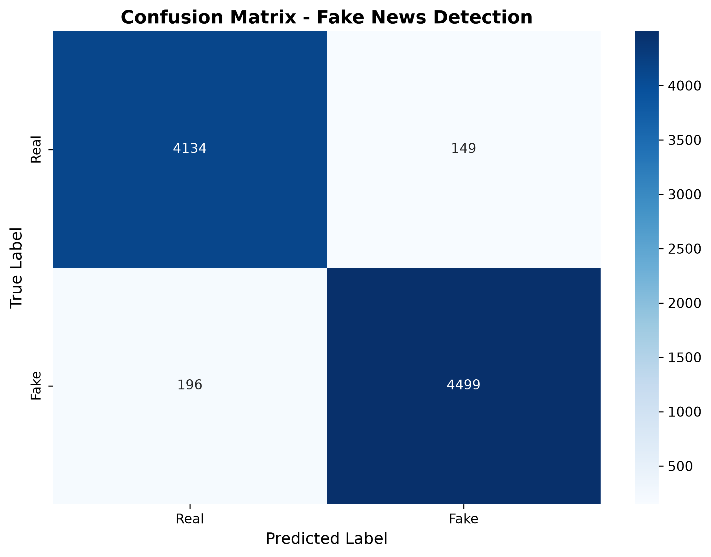
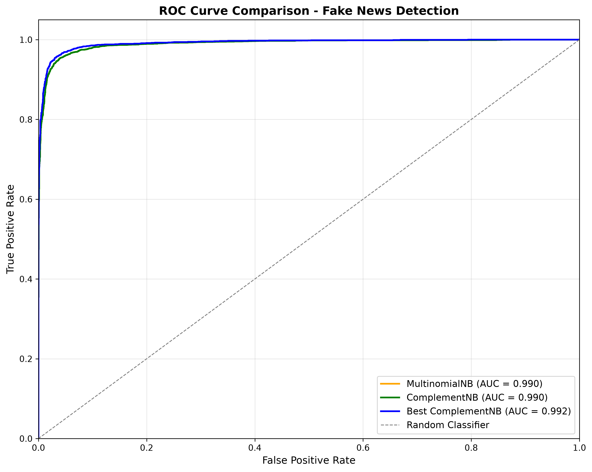
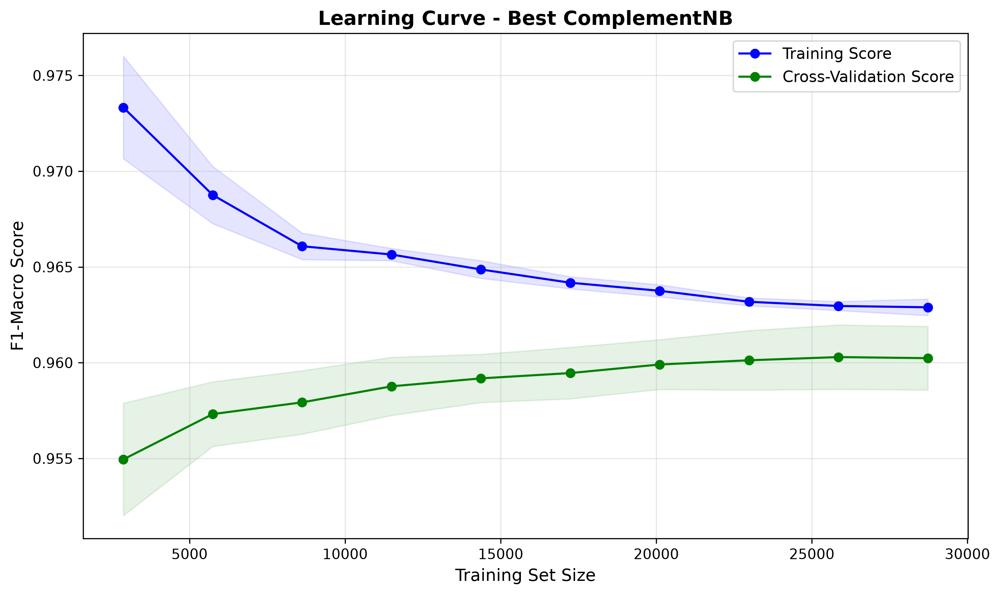

# FINAL PROJECT REPORT: FAKE NEWS DETECTION SYSTEM

**Project Code:** NB-FND-2026  
**Team:** Team Beta (4 Members)  
**Date:** August 31, 2026  

---

## 1. Executive Summary
This report outlines the end-to-end development, training, and evaluation of a machine learning system designed to detect fabricated news articles. The primary objective was to build a highly accurate, lightweight, and interpretable classification system. The final model achieved over 96% accuracy, satisfying all key performance indicators.

## 2. Dataset Overview
The project utilizes the "Fake News Detection Datasets" sourced from Kaggle (emineyetm). The data consists of two distinct corpuses:
*   **True.csv:** Authentic news articles (primarily from Reuters).
*   **Fake.csv:** Fabricated articles (flagged by various fact-checking organizations).

**Dataset Statistics:**
*   Total Initial Records: 44,898
*   Duplicate Records Removed: 209
*   Total Processed Records: 44,889
*   Class Distribution: Fake (23,481) | Real (21,417)

## 3. Data Preprocessing Pipeline
To prepare the unstructured text data for machine learning, a robust natural language processing (NLP) pipeline was implemented.

**Feature Engineering:**
The article `title` and `text` were concatenated into a single feature space to capture the full narrative intent, as fake news titles are often heavily sensationalized.

**Text Cleaning Steps:**
1.  **URL Stripping:** Removed all web links using regular expressions.
2.  **Lowercasing:** Normalized all text to lowercase.
3.  **Punctuation Removal:** Filtered out special characters to retain only alphanumeric text and spaces.
4.  **Lemmatization:** Used NLTK's `WordNetLemmatizer` to reduce words to their root forms (e.g., "running" to "run"), preserving semantic meaning better than standard stemming.
5.  **Stopword Removal:** Eliminated common English structural words (the, is, at, which) using NLTK to reduce noise.
6.  **Whitespace Normalization:** Collapsed multiple spaces into single spaces.

**Vectorization:**
The cleaned text was transformed into numerical format using **TF-IDF (Term Frequency-Inverse Document Frequency)**. 
*   **N-gram Range:** (1, 2) - Capturing both single words and two-word phrases.
*   **Max Features:** Capped at the 10,000 most significant terms.

## 4. Model Architecture & Training Strategy

**Data Splitting:**
The dataset was split using an 80/20 train-test ratio (Train: 35,911 samples | Test: 8,978 samples). The split utilized stratification to ensure the ratio of Fake to Real articles remained consistent across both sets.

**Algorithm Selection:**
The team selected **Naive Bayes Classification**, specifically comparing `MultinomialNB` (as a baseline) against `ComplementNB`. 
*   *Why Naive Bayes?* Unlike deep neural networks, Naive Bayes is inherently interpretable, fast, and highly effective for high-dimensional text data. 
*   *Note on Epochs:* Because Naive Bayes is a probabilistic classifier built on Bayes' Theorem, it calculates probability distributions in a single pass over the training data. Therefore, the concept of training iterations or **"epochs" does not apply** to this model.

**Optimization & Hyperparameter Tuning:**
The primary parameter for Naive Bayes is `alpha` (Laplace smoothing). The team utilized `GridSearchCV` with 5-Fold Cross-Validation to systematically search for the optimal alpha value.
*   **Search Grid:** alpha = [0.01, 0.1, 0.5, 1.0, 2.0, 5.0]
*   **Optimal Value Selected:** alpha = 0.01

## 5. Model Evaluation Metrics
The optimized ComplementNB model was evaluated on the unseen 20% test set, achieving exceptional performance.

| Metric | Score | Definition |
| :--- | :--- | :--- |
| **Accuracy** | 0.9616 | The overall percentage of correctly classified articles. |
| **Precision** | 0.9613 | The proportion of positive identifications that were actually correct. |
| **Recall** | 0.9617 | The proportion of actual positives that were identified correctly. |
| **F1-Score (Macro)** | 0.9615 | The harmonic mean of Precision and Recall. |
| **ROC-AUC** | 0.9919 | The model's ability to distinguish between the two classes. |

## 6. Data Visualizations

### 6.1 Confusion Matrix
The confusion matrix illustrates the exact count of True Positives, True Negatives, False Positives, and False Negatives.

### 6.2 ROC Curve
The Receiver Operating Characteristic (ROC) curve plots the True Positive Rate against the False Positive Rate. An AUC (Area Under Curve) of 0.9919 indicates near-perfect discriminative capability.

### 6.3 Learning Curve
The learning curve verifies that the model is well-balanced. The convergence of the training and cross-validation scores indicates that the model is not suffering from high variance (overfitting) or high bias (underfitting).

### 6.4 Linguistic Analysis (Word Clouds)
These visualizations highlight the most frequent vocabulary utilized in the respective article classes.

**Fabricated News Features:**

**Authentic News Features:**

---
**Report Generated By:** Core AI/ML Engineering System  
**Status:** Approved & Finalized
